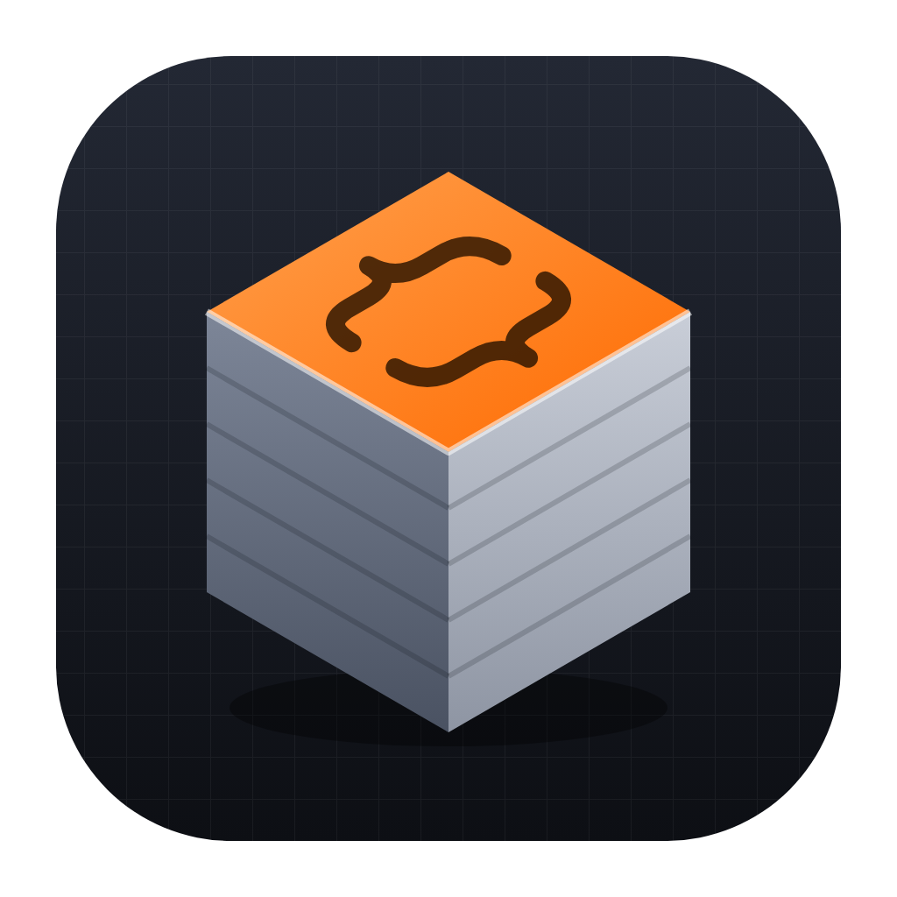

<p align="center"></p>

# ScadLab


[](https://buymeacoffee.com/rhidalgo)
[](https://www.patreon.com/16966547/join)

**Diseño 3D con OpenSCAD e IA, listo para imprimir en tu impresora: Bambu Lab, Prusa, Creality, Elegoo, Anycubic, Snapmaker o UltiMaker.**

ScadLab es una app de escritorio para macOS y Windows donde describes una pieza,
un agente de IA (Claude Code, opencode, Codex o Antigravity, u Ollama en local)
la escribe en OpenSCAD dentro de tu proyecto, y tú la ves, la mides, comparas
versiones y la exportas a STL o 3MF multicolor para tu impresora. El catálogo trae las siete
marcas —Bambu Lab (A1, P1S, X1C, H2D…), Prusa (MK4S, CORE One…), Creality (K1, Ender-3 V3…), Elegoo
(Centauri Carbon…), Anycubic (Kobra…), Snapmaker (U1…) y UltiMaker (S5, S7…)— con su ficha, su skill
y su slicer; cada workspace elige la suya, con sus colores y sus skills.

📖 **Ayuda:** [English](https://rafael180496.github.io/scad-lab/) ·
[Español](https://rafael180496.github.io/scad-lab/es/)

## Qué hace

Todo lo de esta tabla está implementado y probado contra un OpenSCAD real; lo único
pendiente es la verificación manual en ventanas reales (ver abajo).

| | Estado |
|---|---|
| Workspaces con reglas para la IA y skills de modelado para todos los agentes; detección de OpenSCAD y de los CLIs; primer `.scad` de entrada en cada workspace nuevo | ✅ |
| Proveedores de IA (Ollama local o remoto, OpenAI-compatible, OpenRouter, Gemini, Anthropic…) con claves cifradas con tu contraseña maestra (que puedes recordar en el llavero del sistema) y «Probar conexión» | ✅ |
| Árbol de checkpoints con ramas, padre activo, papelera, historial por archivo con «Deshacer cambio de la IA» y diferencias, renombrar, comparar con el padre y retomar la sesión que los creó | ✅ |
| Render con OpenSCAD (Manifold/CGAL), caché de mallas, diagnósticos con línea y `RENDER_ERRORS.md` | ✅ |
| Visor 3D PBR: siete vistas, wireframe, aristas, ortográfica/perspectiva, vista dividida, captura PNG | ✅ |
| Impresoras de siete marcas: catálogo con ficha y búsqueda, y por workspace la impresora, los colores, las skills y los ajustes de impresión («Configuración del workspace») | ✅ |
| Medición por partes (color), peso, filamento y costo estimados, aviso si no cabe en la placa | ✅ |
| Editor Monaco con resaltado OpenSCAD, linter (SL001–SL009), formateo, autocompletado y guardar como checkpoint | ✅ |
| Paneles acoplables (mover, dividir, flotar, minimizar, ocultar), diseños guardados y modo enfoque | ✅ |
| Varios proyectos a la vez: pestañas de proyecto (hasta 4) con indicadores de fondo | ✅ |
| Terminal integrada con el agente (PTY), sesiones y auto-iteración de errores | ✅ |
| Hermes: chat que usa las herramientas de ScadLab (crea, renderiza, mira, mide y corrige checkpoints), con adjuntos (imágenes y modelos STL/3MF/OBJ), conversaciones, tokens y costo | ✅ |
| Servidor MCP de OpenSCAD (`render`, `measure`, `preview`, `export`…) configurado solo en cada CLI | ✅ |
| Exportación STL / 3MF multicolor para Bambu y Orca o para PrusaSlicer (una parte por color con su extrusor) / STL por color / PNG, y abrir en el slicer de la impresora (Bambu Studio, OrcaSlicer, PrusaSlicer, Creality Print, ElegooSlicer, Anycubic Slicer Next, Snapmaker Orca, UltiMaker Cura) | ✅ |
| Interfaz y ayuda en inglés y español | ✅ |
| Probar en una Windows real y en las ventanas reales de Wails (WebGL, Monaco, arrastre de pestañas), con CLIs de agente reales y en cada slicer | ⬜ pendiente de verificación manual |

Plan completo por fases: [claude/01-roadmap.md](claude/01-roadmap.md).

## Requisitos

- macOS 11+ (Apple Silicon) o Windows 10/11 (x64, WebView2).
- [OpenSCAD](https://openscad.org/downloads.html) — se recomienda un snapshot 2025
  (backend Manifold y 3MF con colores). ScadLab **no lo incluye**.
- Opcional: Claude Code, opencode, Codex, Antigravity (`agy`) u Ollama.

## Descargas

Versión **0.2.2**, en los assets del
[Release v0.2.2](https://github.com/rafael180496/scad-lab/releases/tag/v0.2.2):

| Sistema | Archivo | Tamaño |
|---|---|---|
| macOS (Apple Silicon, 11+) | [`ScadLab-v0.2.2.dmg`](https://github.com/rafael180496/scad-lab/releases/download/v0.2.2/ScadLab-v0.2.2.dmg) | 18,6 MB |
| Windows (x64) | [`ScadLab-v0.2.2-windows-amd64.exe`](https://github.com/rafael180496/scad-lab/releases/download/v0.2.2/ScadLab-v0.2.2-windows-amd64.exe) (portable) | 49,6 MB |

Los binarios no van firmados: macOS pide «clic derecho → Abrir» la primera vez y
Windows muestra el aviso de SmartScreen. También puedes compilarla desde el código
(`wails build`, ver «Desarrollo»). Más en la ayuda:
[Instalación](https://rafael180496.github.io/scad-lab/es/#instalacion).

## Desarrollo

```bash
./scripts/install.sh      # Go 1.27, Wails CLI, pnpm
./scripts/start-dev.sh    # wails dev
go test ./...
cd frontend && pnpm build
```

Arquitectura, reglas y agentes de desarrollo: [CLAUDE.md](CLAUDE.md).

## Distribución / Empaquetado macOS

**v0.2.2** — [`ScadLab-v0.2.2.dmg`](https://github.com/rafael180496/scad-lab/releases/download/v0.2.2/ScadLab-v0.2.2.dmg), 18,6 MB, SHA-256
`a30b5712036e76310a1cebb4f2a693afa4d30b1569513669fec753c8248e4dc5`. Solo Apple Silicon
(arm64), macOS 11 o superior (el `Info.plist` que genera Wails declara 10.13, pero el
binario es arm64 y exige 11+). Sin firma ni notarización: clic derecho → Abrir.
Detalle en [releases/macos](releases/macos/README.md).

## Distribución / Empaquetado Windows

**v0.2.2** — [`ScadLab-v0.2.2-windows-amd64.exe`](https://github.com/rafael180496/scad-lab/releases/download/v0.2.2/ScadLab-v0.2.2-windows-amd64.exe), 49,6 MB,
SHA-256 `705ffccf23ecb0db0cb2ef63a983de757315d0b82d1b882fa0c71a49d4251262`. Portable (x86-64),
sin instalador ni firma Authenticode (SmartScreen avisa). Verificado por el usuario en
Windows 10 y 11 en la v0.2.0; la 0.2.2 no se probó todavía en Windows. Detalle en [releases/windows](releases/windows/README.md).

## Apoya el proyecto

ScadLab es gratis, de código abierto y sin telemetría, y va a seguir así. Si te
ahorra horas de modelado y quieres que siga creciendo, puedes apoyarlo:

<p>
  <a href="https://buymeacoffee.com/rhidalgo"></a>
  <a href="https://www.patreon.com/16966547/join"></a>
</p>

- **Buy Me a Coffee** — un aporte único: [buymeacoffee.com/rhidalgo](https://buymeacoffee.com/rhidalgo)
- **Patreon** — una suscripción mensual: [suscribirse](https://www.patreon.com/16966547/join) · [ver la página](https://www.patreon.com/cw/TotoLab2026)

También está a un clic desde la app: el pie de **Configuración**.

## Licencia

[MIT](LICENSE) — Copyright (c) 2026 rafael.

ScadLab **no incluye** OpenSCAD: lo invoca como programa externo instalado por
el usuario (OpenSCAD se distribuye bajo GPL-2.0). Las librerías que un workspace
instale en `lib/` (BOSL2, MCAD, NopSCADlib…) conservan su propia licencia.
